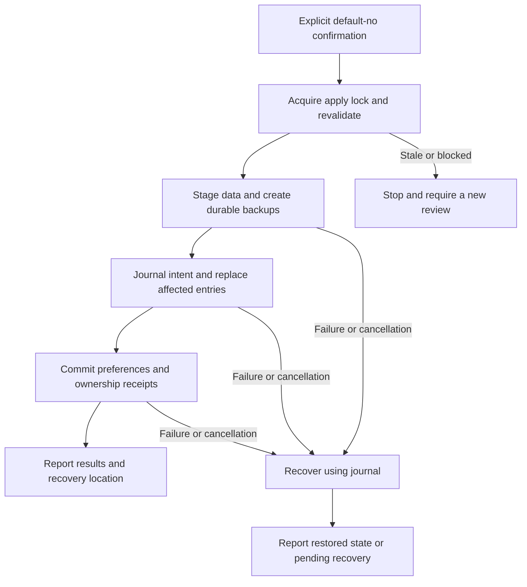
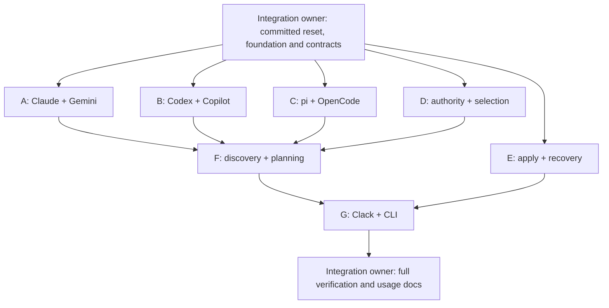

# mishmash architecture and parallel implementation plan

## Status and scope

This is the implementation design for [REQUIREMENTS.md](REQUIREMENTS.md), which remains authoritative. Implementation has started under the user's authorization. The shared foundation provides real snapshot, skill-reading and state-codec behavior; product readiness still requires the complete journey and verification gate below. No historical application code is reused.

Build one npm package with TypeScript ESM, Node.js **22.20 or newer**, a straightforward `tsc` build, `@clack/prompts`, and Vitest. No monorepo, Ink/React, custom renderer/picker, generic workflow framework, dependency-injection container, agent installer, daemon, telemetry, or terminal automation harness.

**Central decision:** the native or shared source chosen by the user remains authoritative at its actual location. mishmash owns synchronization metadata, not a new canonical resource store.

## 1. Responsibilities and dependency direction

| Module | Single responsibility | Effects allowed |
| --- | --- | --- |
| `src/model.ts` | Shared domain values and operation/precondition types | None; no Clack or native parser imports |
| `src/agents/contract.ts` | Adapter input/output and capability contracts | Types only |
| `src/agents/<agent>.ts` | Native paths, evidence of presence, supported scopes, parsing and targeted document edits for one agent | Read approved locations; return data/encoded edits, never write or launch processes |
| `src/agents/index.ts` | Register the six adapters | Composition only |
| `src/resources/skills.ts` | Read standard `SKILL.md` metadata and construct skill resource instances from an approved root/provenance | Read-only; reuse snapshots, no native placement or authority decisions |
| `src/core/discover.ts` | Inventory resources, provenance, checked locations and actionable findings | Filesystem reads through snapshots/adapters |
| `src/core/authority.ts` | Resolve explicit source choices and selected-name conflicts | Pure computation |
| `src/core/selection.ts` | Resolve selected stable IDs against the complete inventory and provide resource search predicates | Pure computation; no keyboard or picker state machine |
| `src/core/plan.ts` | Produce deterministic, reviewed operations and preconditions | Reads only; use adapter edits and snapshots |
| `src/fs/snapshot.ts` | Inspect paths, trees, content, modes and symlinks | Filesystem reads only |
| `src/state.ts` | Read/validate preferences and receipts; encode intended metadata updates | Reads only; return write intents for apply |
| `src/fs/apply.ts` | Execute a confirmed plan with backups and a durable journal | Filesystem mutation, including metadata, only after confirmation |
| `src/fs/recover.ts` | Settle or recover an interrupted transaction | Filesystem mutation under the same lock and explicit recovery decision |
| `src/ui/flow.ts` | Ask sequential Clack questions, preserve answers on backtracking, review and confirm | Prompts/output; call core services, not native file editors |
| `src/ui/render.ts` | Render compact, sanitized resource labels, details and results | Terminal output only; never configuration bodies |
| `src/cli.ts` | Arguments/help, TTY policy, dependency composition, process signal and exit lifecycle | Process/terminal lifecycle; delegate actual writes |

Keep modules as ordinary functions and small records. Do not introduce base adapter classes, a plugin host, a generic filesystem mock framework, or a wizard DSL. Use a small helper only when multiple real callers need it.

Dependencies point from CLI/UI toward core, adapters and filesystem services. Core never imports UI or Clack; adapters never import the workflow or transaction engine. Planning cannot call apply. Metadata serialization cannot write behind the planner's back. Shared contracts do not import their implementations.

Pass project, home, XDG config and XDG state roots explicitly. Only the CLI resolves real process defaults; core tests must never discover the developer's actual profile accidentally. Use Node filesystem APIs directly rather than a universal injectable filesystem abstraction.

Share the standard skill reader across native adapters and explicitly supplied shared sources; do not write six frontmatter parsers. Adapters own agent-specific locations and configuration semantics; the resource reader owns the common skill format; snapshots own tree evidence. Native parsed-document types remain adapter-local.

## 2. Domain and contract invariants

| Value | Contract |
| --- | --- |
| `Context` | Approved project/home/XDG roots, explicit placement/configuration scope, and cancellation signal where applicable |
| `SourceRef` | Exact native/shared source location, agent associations, logical project/user scope and private/shared visibility |
| `ResourceInstance` | Stable ID from source identity plus skill-relative path or MCP registration locator **and, when parser semantics differ, native-agent interpretation**; includes description and provenance |
| `Snapshot` | Separate content/tree fingerprint, entry types, supported modes, link targets and resolved parent identity |
| `AuthoritySelection` | Explicit mapping from selected resources/conflicts to exact source instances; never infer authority from list order, timestamp or `.agents` |
| `DestinationSlot` | Resolved physical path plus registration key when several resources share a configuration file |
| `Finding` | Severity, safe code/location and remediation; no raw parser exception, configuration excerpt or credential |
| `Plan` | Selected authorities, operations, resolved scopes/paths, warnings/blockers, expected snapshots and metadata write intents |
| `ApplyResult` | Changed/unchanged/skipped resources and destinations, backup location, recovery status and safe findings |

Resource identity is not a display name or content hash. A `SourceRef.id` is the normalized resolved source path plus logical scope and visibility; it excludes the discovering agent and label. Native adapters realpath existing source roots/configs before constructing `SourceRef`, while `CheckedLocation` retains the configured alias. Shared skill roots use `agentId: 'shared'` and retain detecting agents in provenance; compatibility paths retain their native owner. Identical physical skills discovered via several adapters coalesce into one resource with all provenance. A shared MCP file can have agent-specific interpretation semantics; preserve those as distinct resource views when `nativeAgent` changes, even though the physical `SourceRef` is shared. Same-name resources at different sources or semantic interpretations remain distinct until explicit authority resolves them.

Logical scope is not determined solely by file location: a project-private MCP entry may be stored under the home directory. Do not flatten user resources into project resources. Unclassified privacy must not become permission to publish globally.

The foundation commit must fix concrete TypeScript signatures for discovery, authority resolution, full-inventory selection, planning, snapshots, adapter edits, state encoding and apply/recovery. Favor a few named input/result records; no service locator or generic `execute()` interface. Contract changes require an integration-owner decision and a new shared baseline, not worker-local aliases or casts.

### Entry-point contracts

The concrete domain and adapter shapes are defined in `src/model.ts` and `src/agents/contract.ts`. The shared foundation is implemented; the entry points below are assigned to workers. Keep native parsed-document types inside their adapters and private transaction machinery inside `fs/`, not in a universal model.

| Entry point | Boundary |
| --- | --- |
| `discover(context, adapters)` | Read-only `Promise<Inventory>` with resources, presence evidence, checked locations and findings |
| `resolveSelection(inventory, checkedIds)` | Pure full-inventory `SelectionResolution`; no filtered-list fallback |
| `resolveAuthority(inventory, selection, explicitChoices, rememberedChoices)` | Pure `AuthorityResolution`; unresolved authority remains explicit |
| `planSync(context, inventory, approvedRequest, loadedState, adapters)` | Read-only `Promise<Plan>` with concrete native edit intents, snapshots and metadata writes |
| `applyPlan(plan, { confirmed, signal })` | `Promise<ApplyResult>`; confirmation must be explicitly true before any lock, directory or file write |
| `inspectRecovery(context)` | Read-only `Promise<RecoveryStatus>` |
| `recoverTransaction(transaction, { confirmed, signal })` | `Promise<RecoveryResult>`; explicit approval before recovery writes |

`approvedRequest` contains selected IDs, resolved authority, destination agents, explicit placement and relevant copy/link choices, not callbacks or UI objects. The UI receives a safe plan summary; internal file payloads may contain secrets and must never be serialized into terminal output. Apply rejects false/missing confirmation and already-aborted work without writes. The flow still calls apply only after an affirmative answer; no confirmation-token framework is needed.

The foundation exports `snapshotPath`, `snapshotMatches`, `snapshotsEqual`, `fingerprintValue`, `isWithin` and safe filesystem findings; shared skills use `sourceRef`, `resourceId`, `readSkillDirectory` and `discoverSkills`. `readJsonDocument`/`editJsonDocument` share safe JSONC parsing and targeted edits. State uses `getStatePaths`, `readState` and explicit authority/ownership/journal codecs. Native adapters export named `NativeAdapter` values; `prepareMcpEdit` returns file bytes/preconditions plus per-registration before/after fingerprints so the planner, not the adapter, enforces ownership. These shared readers/codecs never write.

Native JSON/JSONC readers reject duplicate object keys, including nested registrations, before deriving ownership fingerprints or preparing edits. They never silently choose a last occurrence.

## 3. Discovery, authority and selection

Discovery is read-only and bounded to documented native/shared locations plus an explicitly supplied existing source directory. Return both inventory and checked-location findings, including unreadable or invalid sources. Detect agents through filesystem/configuration evidence only. Never invoke launchers, MCP servers, skill scripts, credential helpers or network requests.

Initially cover Claude Code, Codex, GitHub Copilot CLI, pi, OpenCode and Gemini CLI. Each adapter documents verified paths, supported native formats, project/user/private placement and resource/transport limitations. Agent coverage does not imply every agent supports every resource kind or scope. Block unsupported placement/translation rather than invent a layout or install an extension.

Ask which source is authoritative, independently from destination selection. Additional sources can supply other resources, but a selected divergent duplicate requires an explicit source choice. Never automatically merge skill directories or choose the newest source. Even identical independent copies need an unambiguous edit location.

Persisted authority is a reviewable preference. If a remembered source is missing, unreadable or resolves differently, show a finding and ask again; do not substitute another directory or silently rewrite the choice.

Use stable resource IDs throughout. Search predicates filter visible options; selection resolution always uses the full inventory. Unknown/stale selected IDs require a visible correction, not accidental selection by position or name. No custom checkbox reducer, focus system or hidden-choice mutation is needed.

## 4. Native resources and destination policy

### Skills

A skill is its complete directory tree, not just `SKILL.md`. Preserve assets, references, empty directories and supported executable modes. Inspect root/nested symlinks and special files; reject path traversal, escaping nested links or unsupported entry types rather than copying unexpected external data. Resolve and show the authoritative root explicitly.

Ask copy versus link only when selected resources/destinations support that choice. Copies require another synchronization after source edits; links remain connected to the authority. If an agent already discovers the authoritative physical directory, report that rather than creating redundant links or silently retained destinations.

### MCP definitions

Use a small transport-aware representation for supported semantics, not a universal canonical schema. Preserve complete selected entries for compatible native formats. Cross-format conversion must account for execution-affecting fields; block a conversion that would silently discard them. Never resolve secrets or infer active, trusted, authenticated or connected state.

Use syntax-aware editors appropriate to actual JSON/JSONC/TOML documents. Prepare targeted edits that preserve unrelated settings and unchecked registrations. Credentials may need to reach an explicitly approved destination configuration, but never preferences, logs, summaries, snapshots in test output or error excerpts. Review warns about portability and sensitive placement before apply.

### Ownership and collisions

- An unmanaged, different destination is blocking; there is no force-overwrite option.
- A selected managed output changed since its last-applied receipt is blocking drift.
- Identical unmanaged output may remain untouched without silently adopting ownership.
- Unchecked resources and unrelated native settings remain untouched.
- Removals are limited to obsolete entries inside a selected managed output being updated, and appear in review. There is no implicit pruning of deselected resources.
- Coalesce edits targeting the same physical file or shared directory. Conflicting writes to the same destination slot block even if their labels differ.
- Choosing an agent as authority does not add it as a destination.

## 5. Persistence without a canonical content store

| Record | Proposed location | Contents |
| --- | --- | --- |
| Shared project authority choices | `<project>/.mishmash/sources.json` | Exact source references and explicit authority overrides; moving context requires review rather than silently relocating authority |
| User authority choices | `$XDG_CONFIG_HOME/mishmash/sources.json` | User-wide source references |
| Private project authority choices | `$XDG_CONFIG_HOME/mishmash/projects/<project-id>.json` | Private choices keyed by real project root; never copied into a shared project file |
| Ownership receipts | `$XDG_STATE_HOME/mishmash/ownership.json` | Physical destination slots, source identities and last-applied fingerprints |
| Transaction journal/backups | `$XDG_STATE_HOME/mishmash/transactions/<id>/` | Recovery instructions and original affected data |

Honor platform-appropriate XDG fallbacks. Use versioned JSON and explicit validation. Select the relevant authority configuration for review; do not silently combine conflicting project/private/user choices or use one as a missing-source fallback. Configuration scope and output placement are separate decisions.

Preferences and receipts contain locators and fingerprints, not MCP bodies or credentials. Backup directories are owner-only; secret-bearing backup files are owner-readable/writable only. Preserve supported target modes independently. Include preference/receipt changes in the reviewed transaction. No directory, lock, state file, backup or `.gitignore` change occurs before confirmation. An unchanged rerun does not rewrite metadata or create a transaction directory just to log a no-op.

## 6. Read-only planning and recoverable application

A plan includes exact authorities, resources/counts, destination agents/scopes/paths, copy/link/generated-config behavior, additions/updates/removals/unchanged items, warnings/blockers and expected snapshots. Snapshot source trees, affected destination files/entries, ownership records and relevant parent/symlink identities. No blocking plan can be applied.



Apply accepts the concrete confirmed plan, not unvalidated UI answers. Revalidate the complete review before resource mutation, verify staged source content matches the reviewed snapshot, and recheck destinations immediately before replacement. Stage file replacements on the target filesystem; do not assume the private backup store is on the same device.

Make original data and journal intent durable before changing originals. Track file/link/directory changes and metadata as one recoverable transaction, using safe per-file replacement. Never claim filesystem-wide atomicity or that readers cannot observe intermediate tree changes.

A global mishmash apply lock serializes mishmash writers and ownership updates, not external editors. Preconditions detect stale reviews and narrow races; they do not provide isolation against arbitrary concurrent processes. Rollback must not overwrite a new external edit: preserve recovery data, report a pending recovery, and block another apply until an explicit recovery decision.

The apply lock is protected by a short-lived exclusive sibling guard during acquisition/reclamation; an owner-verified release never removes a replacement lock. A stranded, corrupt or unknown-owner guard blocks writes and is surfaced at its exact path. Do not auto-delete it: stop all mishmash writers, verify the recorded owner is inactive, then follow the documented recovery procedure. Reclaim a dead apply lock only through explicit recovery approval. Missing XDG state roots are created with private permissions only after confirmation; false confirmation and read-only planning create none. Completed journals remain available for backup/recovery history but no longer require their former project root to exist.

Before apply, cancellation performs no writes. During apply, catchable cancellation requests safe settlement/recovery; do not call `process.exit()` in the middle of a write. On the next run, surface an interrupted journal before another apply. Do not claim a no-write cancellation if mutation began.

## 7. Clack interaction and process lifecycle

The default `mishmash` invocation starts discovery in the selected/current project. Initially expose only `--help` and `--version` beyond that journey; context changes belong in prompts. Non-TTY invocation prints plain usage and exits without raw mode, animation or a blocked prompt. A noninteractive synchronization API is not required for this rewrite.

At the start of the normal interactive run, render the user's supplied **mishmash** ASCII logo exactly once, before discovery/loading and the first prompt. Use a plain Clack message so it remains in ordinary scrollback, readable with color disabled; do not add a repeated intro/banner or custom renderer. At 60-column width, preserve the artwork verbatim and let the terminal wrap naturally rather than clipping or altering its characters. Non-TTY usage remains plain help without prompt-control sequences.

```text
███    ███ ██ ███████ ██   ██ ███    ███  █████  ███████ ██   ██
████  ████ ██ ██      ██   ██ ████  ████ ██   ██ ██      ██   ██
██ ████ ██ ██ ███████ ███████ ██ ████ ██ ███████ ███████ ███████
██  ██  ██ ██      ██ ██   ██ ██  ██  ██ ██   ██      ██ ██   ██
██      ██ ██ ███████ ██   ██ ██      ██ ██   ██ ███████ ██   ██
```

Use the library's ready-made `autocompleteMultiselect`, `select`, `confirm`, cancellation and spinner/task components. `autocompleteMultiselect` provides filtering, `initialValues`, `required` and bounded `maxItems`; verify against the pinned release. See the [Clack API](https://github.com/bombshell-dev/clack/tree/main/packages/prompts) and [interaction reference](https://github.com/vercel-labs/skills). Do not copy a custom picker from the reference project.

- Stop discovery loading with a useful detected-resource summary; distinguish detected agents from supported-only destinations.
- Empty discovery offers checked-location details, context change or an existing source directory instead of an empty picker.
- Separate skills and MCP prompts; skip irrelevant questions. Validate combined nonempty selection at prompt level.
- Pass full stable-ID options to Clack and preserve answers with `initialValues` on backtracking. Library filtering controls visibility, not authority.
- Keep names, useful descriptions, source labels and scope compact. Offer full paths/provenance through normal details/review choices, not a dashboard or overloaded option labels.
- Review actions allow details, changes, cancellation or apply. Final confirmation defaults to no writes.
- Backtracking that changes authority/destinations invalidates the old plan; show the rebuilt plan before confirmation.
- Sanitize filesystem-derived text before rendering. Never print MCP bodies, sensitive arguments/headers/environment values or raw native parser errors.
- Honor disabled color and Clack's own keyboard instructions. Use normal scrollback; do not clear the screen or enter alternate screen.
- Wrap actual work with spinners that stop in `finally`; no artificial waits or fake percentages. The CLI owns signal handlers; prompt and apply lifecycles consume cancellation without leaking listeners or intervals.
- Print the logo once before discovery; redraw neither on prompt backtracking nor after an empty-discovery context change.

UI functions call the same real core used by tests. There is no second UI-specific synchronization implementation.

## 8. Vitest verification contract

### Real filesystem, isolated roots

Each test gets a unique disposable root containing `project/`, `home/`, `xdg-config/` and `xdg-state/`. Pass those paths explicitly; do not modify process-global home/XDG/cwd for core tests or inspect real profiles. Clean only the sandbox created by the test. Use non-default XDG paths so hard-coded home layouts fail.

Assertions inspect actual bytes, entries, modes, symlink targets, receipts, backups and journals. Capture before/after trees and modification times for read-only/no-op behavior; access-time changes from reads are not application writes. No fake filesystem, mock-success applier, snapshot of prompt wording, source-text architecture test or mock that merely echoes a selection.

For deterministic failure/cancellation, use a narrow transaction checkpoint or path-scoped one-shot failure after a real first replacement; successful writes and recovery still use the real filesystem. Do not depend on sleeps, permission failures that disappear under root, or a custom subprocess/PTY harness. Tests never launch agents, MCP servers, skill scripts, authentication or credential helpers; fail-on-use execution guards can catch accidental calls without running them.

### Required behavior coverage

Numbers identify the corresponding items in [required core coverage](REQUIREMENTS.md#required-automated-core-coverage). Each behavior has one primary test owner; integrated cases use the real adapter, planner and transaction implementations after they land.

| Requirement | Primary owner | Filesystem-backed acceptance |
| --- | --- | --- |
| Discovery metadata — 116 | Native adapters; discovery | Correct names, descriptions, exact native/shared sources, agent associations, project/user/private scope, checked locations and safe unreadable/malformed-source findings for all six agents |
| Actual authority — 117 | Authority; integrated planning/apply | Same-named sources with distinguishable assets/MCP fields: each explicit choice uses that source's actual content and leaves the source location authoritative |
| Explicit conflicts — 118 | Authority; planning | Divergent names without a winner block, including select-all; choosing one never adds an unchecked competitor's assets/fields; identical duplicates retain provenance |
| Remembered authority — 119 | State; integrated planning/apply | Confirmed project/user/private choices persist at the approved location and read back exactly; missing/changed sources require review without fallback; merely reading/selecting/planning creates nothing |
| Stable selections — 120 | Selection; integrated discovery | Discover real duplicate-name resources, hide a checked ID with the production search predicate, then resolve all checked IDs from full inventory; hidden choices survive; reordered/edited resources do not bind to another source; stale IDs produce findings |
| Selected subset — 121 | Adapter edits; planning/apply | Only selected skills/server keys change; unchecked resources and unrelated native settings survive; edits sharing a physical file coalesce; removal of an obsolete selected owned asset is explicit |
| Placement/privacy — 122 | Adapters; planning/apply/state | Every advertised project/user/private placement resolves correctly; private-to-shared/global publication and unsupported placement block; only approved outputs and disclosed metadata locations change |
| Read-only/no execution — 123 | Discovery; planning; snapshot/state readers | Before/after bytes, entries, link text, modes and mtimes match; no absent state/temp directory is created; executable/script/helper/MCP sentinels are never invoked |
| Decline/cancel/failure — 124 | Apply/recovery | False confirmation and already-aborted work create no locks/backups/output/state; cancellation and failure after a real write settle/recover safely; recovery failure retains usable data and blocks later apply until approved recovery completes |
| Unsafe writes blocked — 125 | Planning; apply/snapshots | Block findings, unmanaged collisions and owned drift; mutate selected source bytes/tree membership/MCP fields, targets, modes or parent links after review and refuse unsafe replacement; identical unmanaged output is not silently adopted |
| Complete assets/modes/backups — 126 | Snapshot; apply/recovery | Preserve nested/binary/dotfile assets, empty directories, permitted internal links and supported executable modes; inspect private preimage backups and real restoration; exercise copy/link separately and block escaping links/special files |
| Repeated no-op — 127 | Planning; apply/state | Apply twice with unchanged input: explicit no-op, unchanged output/state bytes and mtimes, no new backup or transaction; equal-byte rewriting is not accepted as a no-op |
| Safe diagnostics — 128 | Adapters; core; apply/recovery; rendering | Synthetic secret markers in valid/malformed definitions never appear in findings, summaries or error output; hostile terminal controls are sanitized; backup data remains private |

Store secret-bearing fixtures only in temporary files, not committed snapshots or printed assertion objects. Assert safe fields or booleans so a failed test cannot dump a native configuration. Backup/journal files require owner-only permissions on exercised POSIX platforms; do not claim untested platform support.

Clack owns focus, toggling and hidden-selection retention. Core tests prove full-inventory ID resolution, not library keystrokes. Actual filtered selection/clearing, backtracking, default-no, cursor restoration and spinner cleanup remain manual checks in the real terminal.

## 9. Parallel agents and isolated worktrees

### Integration owner and common foundation

One **integration owner** controls the main checkout on `feat/clack-rewrite`, shared contracts, dependencies and merge queue. Workers use separate branches/worktrees and never edit the integration checkout or another worker's files.

**Commit the reset before branching.** Worktrees contain committed trees, not pending deletions or untracked files. The approved reset/document baseline is recorded in `9c34f10`; a verified shared foundation must also be committed before workers branch. The user has now authorized implementation under this protocol.

Before implementation workers start:

1. Obtain authorization to record the reviewed reset/documents and implement the replacement. The integration owner commits exactly the approved reset and documents, excluding unrelated changes; keep Git history.
2. The integration owner implements and commits the common foundation: package/lock/configuration, concrete domain/adapter/transaction contracts, the shared skill reader, real read-only snapshots, state codecs/readers, and disposable-root test helpers with their focused Vitest coverage.
3. Record that foundation SHA and freeze signatures, plan operations/preconditions, missing-path/link/mode semantics, state/journal schemas, confirmation/cancellation results, fixture conventions and owned paths. Only then create worker worktrees.

The foundation is usable shared code, not a placeholder app: no fake inventory, throwing stubs, no-op writer or unfinished adapter registration. Reserved integration paths need not exist before their real dependencies land.

The integration owner exclusively owns:

- `package.json`, `package-lock.json`, `.gitignore`, `tsconfig.json`, `vitest.config.ts` and approved root build/test configuration.
- `src/model.ts`, `src/agents/contract.ts`, `src/agents/index.ts`, `src/state.ts`, `src/fs/snapshot.ts`, `src/resources/skills.ts`, `src/resources/jsonc.ts` and their tests: `tests/state.test.ts`, `tests/fs/snapshot.test.ts`, `tests/resources/{skills,jsonc}.test.ts`.
- `tests/helpers/**`, `tests/fixtures/**`, `tests/agents/contracts.test.ts`, `tests/integration/**` and usage/architecture documentation.

Only this owner installs/adds native-format parser dependencies or changes shared types, helpers, registry and lockfiles. Add the real registry when adapter implementations are merged, not before. `REQUIREMENTS.md` remains authoritative and unchanged by worker slices.

### Exclusive worker assignments

Each source path below includes its corresponding test ownership. Adapter documentation records current primary-source links, exact native paths, scopes, supported MCP semantics and limitations; the pairings do not imply shared native formats.

| Worker / branch | Exclusive source and test paths | Complete deliverable |
| --- | --- | --- |
| A / `impl/native-claude-gemini` | `src/agents/{claude-code,gemini-cli}.ts`; `tests/agents/{claude-code,gemini-cli}.test.ts`; `docs/native/{claude-code,gemini-cli}.md` | Both real native adapters: discovery/provenance, supported placement/capabilities, safe parsing, targeted edit preparation and adapter filesystem tests |
| B / `impl/native-codex-copilot` | `src/agents/{codex,github-copilot-cli}.ts`; `tests/agents/{codex,github-copilot-cli}.test.ts`; `docs/native/{codex,github-copilot-cli}.md` | Same acceptance for Codex and GitHub Copilot CLI, including actual format/transport conversion limits |
| C / `impl/native-pi-opencode` | `src/agents/{pi,opencode}.ts`; `tests/agents/{pi,opencode}.test.ts`; `docs/native/{pi,opencode}.md` | Same acceptance for pi and OpenCode; unsupported native features are findings, not invented integrations |
| D / `impl/authority` | `src/core/{authority,selection}.ts`; `tests/core/{authority,selection}.test.ts` | Pure exact-source decisions, conflict handling, remembered-choice review and stable full-inventory selection/search; no custom picker |
| E / `impl/filesystem` | `src/fs/{apply,recover}.ts`, optional private `src/fs/transaction.ts`; `tests/fs/{apply,recover}.test.ts` | Sole writer/recovery implementation with real backups/journal, locking, rechecks, failure/cancellation settlement, scope safety and no-op coverage |
| F / `impl/discovery-plan` | `src/core/{discover,plan}.ts`; `tests/core/{discover,plan}.test.ts` | Real six-adapter inventory, checked-location findings, deterministic compatible destination planning, coalesced edits, preconditions and metadata write intents |
| G / `impl/clack` | `src/cli.ts`, `src/ui/{flow,render}.ts`, `tests/ui/render.test.ts` | Complete real Clack journey, TTY/help/version lifecycle, safe rendering, review/back/default-no/cancel, actual-work loading and results; no native parsing or writes in UI |

Brace paths are exact alternatives, not permission to edit whole directories. Add small native fixtures inline in owned tests; shared fixture/helper changes go through the integration owner. New files outside assigned ownership require an explicit ownership update. Workers include behavior-focused Vitest tests in the same slice, not a later test-only agent.

### Dependency schedule



Run A/B/C/D/E concurrently from the same committed foundation. D uses complete domain records backed by temporary source files, not fake adapter implementations. E uses concrete contract-valid plans and real files; it does not need the planner to test transactions. The integration owner adds actual cross-module cases after dependencies land.

Start F once A/B/C/D and the real registry are merged; **do not wait for E unnecessarily**. Start G only once F and E are integrated, so the UI uses real services instead of a demo flow. Each worker finishes its owned implementation and then runs its focused Vitest files and typecheck at handoff, not repeated whole-repository checks mid-edit. The integration owner runs the complete suite after final integration and owns terminal smoke checks.

### Worktree creation and merge-back

The commands below describe future implementation only. They are separate accepted-handoff stages, not one unattended script. First require the authorized reset/foundation commits and a clean integration baseline. Never stage unrelated changes, recover historical application files, or use force/reset/clean to prepare a worktree.

```sh
# Integration checkout, at the reviewed committed foundation.
git switch feat/clack-rewrite
BASE=$(git rev-parse HEAD)
git worktree add -b impl/native-claude-gemini ../mishmash-native-claude-gemini "$BASE"
git worktree add -b impl/native-codex-copilot ../mishmash-native-codex-copilot "$BASE"
git worktree add -b impl/native-pi-opencode ../mishmash-native-pi-opencode "$BASE"
git worktree add -b impl/authority ../mishmash-authority "$BASE"
git worktree add -b impl/filesystem ../mishmash-filesystem "$BASE"
```

Each worker runs `npm ci` in its own worktree using the committed lockfile, edits only owned paths and commits only those paths. Dependencies/build output are not shared across worktrees. For example, A's handoff checks are:

```sh
# In ../mishmash-native-claude-gemini, after its implementation is ready.
npm test -- tests/agents/claude-code.test.ts tests/agents/gemini-cli.test.ts
npm run typecheck
```

Review each handoff and diff before accepting it. Merge branches sequentially in the integration checkout; never combine cherry-pick and merge for the same work. The following illustrates dependency order, not a requirement to delay a ready independent branch:

```sh
# Integration owner: accept and merge A/B/C/D in any ready order.
git merge --no-ff impl/native-claude-gemini
git merge --no-ff impl/native-codex-copilot
git merge --no-ff impl/native-pi-opencode
git merge --no-ff impl/authority
# Add and commit the real adapter registry/shared contract coverage first.
git worktree add -b impl/discovery-plan ../mishmash-discovery-plan feat/clack-rewrite

# Later, after separate F and E handoffs are accepted; E may land earlier.
git merge --no-ff impl/discovery-plan
git merge --no-ff impl/filesystem
# Commit integration fixes and actual cross-module tests before creating G.
git worktree add -b impl/clack ../mishmash-clack feat/clack-rewrite

# Later, after accepting G.
git merge --no-ff impl/clack
```

If a merge conflicts, stop the queue; the integration owner resolves the contract/ownership cause with the affected worker or aborts that merge. Do not continue merging on an unresolved checkout. No worker merges itself into the integration branch.

Keep worker branches/worktrees until accepted and merged. Optional removal requires the exact worker tip to be an ancestor of `feat/clack-rewrite` and a clean worktree with no untracked deliverables. Use ordinary `git worktree remove` and `git branch -d` only then; never force-remove or discard unmerged work.

### Shared changes and concise agent instructions

A worker requests a shared change before editing a contract/dependency/helper: name the requirement, exact signature/schema/package delta and affected owners. The integration owner makes one central commit and publishes its SHA. Affected workers merge the updated integration branch into their clean worktrees, adapt only owned files and rerun focused checks. Do not add shadow types, casts, compatibility aliases or private lockfile changes to evade the agreement.

Use this short launch brief:

```text
Slice: <A-G>; branch/worktree: <assigned branch and absolute path>
Base: <committed prerequisite SHA>; prerequisites: <merged dependencies>
Read: REQUIREMENTS.md, ARCHITECTURE.md, frozen contracts and owned files
Own: <exact source/test/native-doc paths from the table>
Deliver: <complete slice behavior>; no adjacent features or placeholders
Check once ready: <owned Vitest files>; npm run typecheck
Shared changes: request integration owner; never edit another owner's paths
Output: blockers/contract requests only during work; final handoff <=5 bullets
```

Final handoff, **at most five concise bullets**, no source dumps or tool transcripts:

```text
- Branch/base/tip: <branch> / <SHA> / <SHA>
- Changed: <owned paths; one-line behavior>
- Checks: <exact commands> — PASS/FAIL/NOT RUN; <observed result>
- Contracts: unchanged | <approved shared-change SHA>
- Blockers: none | <precise unmet requirement and prerequisite>
```

No repeated progress narration, full-plan restatement, credential-bearing output or claim of overall readiness from an isolated slice. Failed/unrun acceptance is not a completed handoff. Report blockers immediately; do not silently reduce scope.

## 10. Integrated completion gate

The foundation must provide these future scripts; they do not exist merely because this document names them:

| Command | Contract |
| --- | --- |
| `npm test` | Non-watch `vitest run` of behavior-focused suites |
| `npm run typecheck` | `tsc --noEmit` against actual contracts and implementations |
| `npm run build` | Real TypeScript ESM build for Node.js >=22.20 |

After all branches and integration fixes land, the integration owner runs the full Vitest suite, typecheck and build against the real merged implementation. Exercise real-filesystem source selection, subset preservation, collisions/drift, cancellation/recovery, backups and no-op behavior through the integrated services, not only isolated module fixtures.

Run the actual built CLI at **60x20 and 100x30**, with disabled color and piped input. Check discovery/checked-location output, explicit authority, skill/MCP multiselect and hidden selections, destination placement, details/default-no, back/cancel before writes, settlement during apply, cursor/input restoration, spinner cleanup, success/error/recovery output and unchanged reruns. Use manual terminal checks, not a new PTY harness or terminal automation dependency.

Update usage documentation with the actual commands, edit locations/source-of-truth semantics, supported native paths/limitations, copy/link effects and backup/recovery procedure. Remove temporary verification scaffolds. The final report includes only observed checks and concrete blockers; no untested-platform or filesystem-wide atomicity claims. The replacement is complete only when the entire required journey and safety gate pass.
